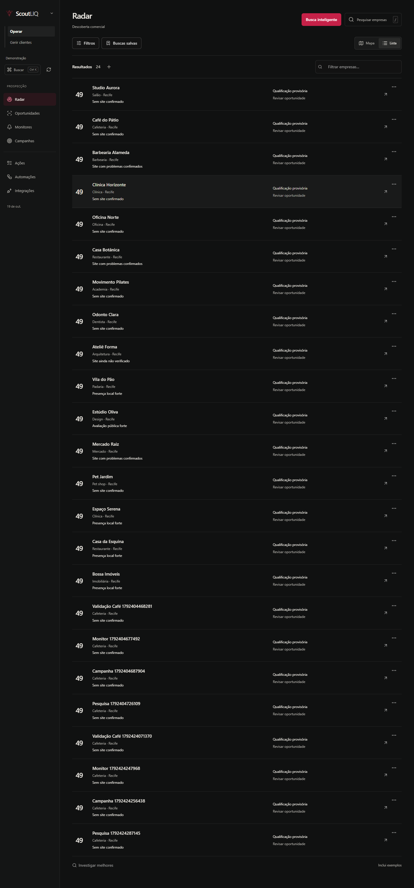
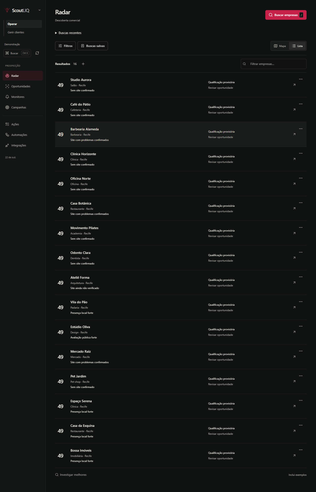
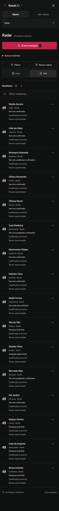
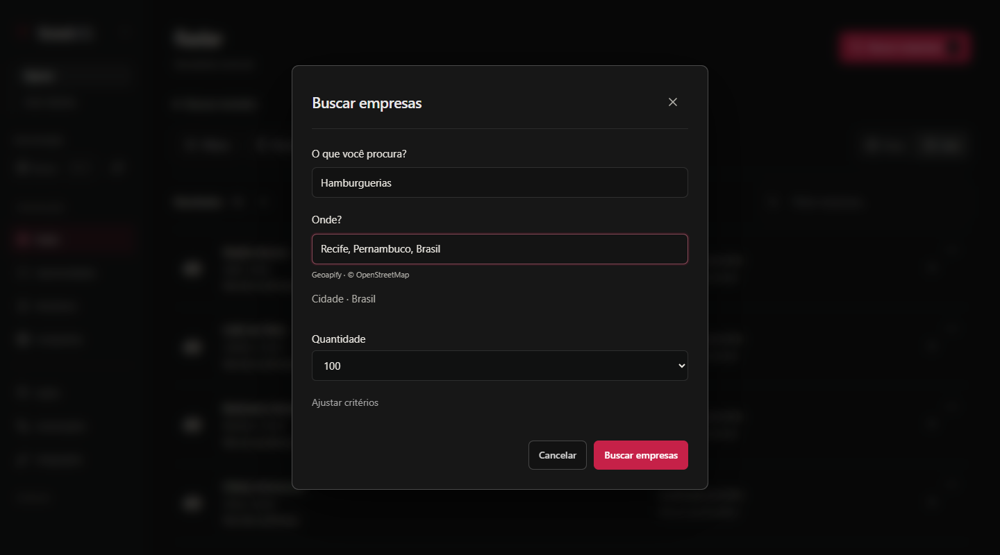
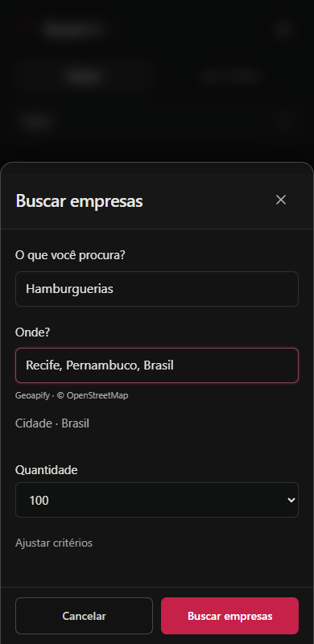
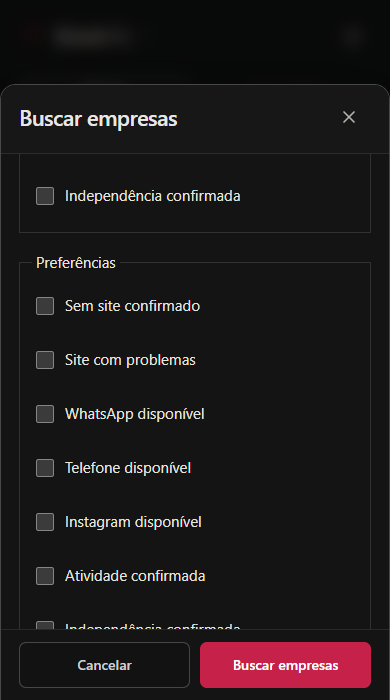
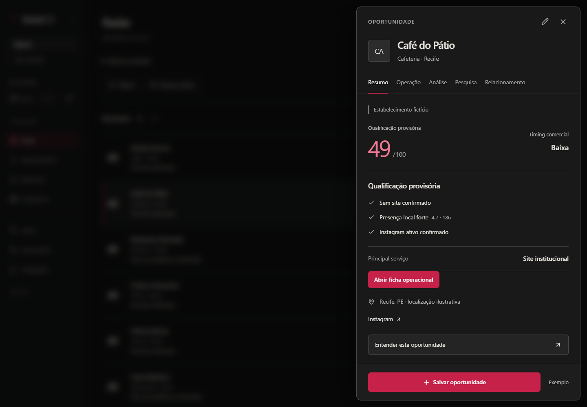

# Antes/depois — ScoutLIQ v1.37

As imagens anteriores abaixo vêm da entrega FULL v1.36, preservadas com seu manifesto. As imagens atuais vêm do build local com dados sintéticos em 22/10/2026; não são mockups. A quantidade 100 visível na captura é uma seleção exercitada no teste, não mudança do padrão 50.

| Aspecto | v1.36 | v1.37 |
|---|---|---|
| Pesquisa | Entradas e configurações concorrentes | Um formulário de três campos |
| Geografia | Texto/contexto e caminhos diferentes | Catálogo por ID ou área do mapa no contrato comum |
| Acompanhamento | Modal extenso | Progresso/histórico persistentes no Radar |
| Revisão | Dentro da busca | Ficha contextual; confirmação rápida e alteração justificada |
| Fundo do diálogo | Competia com o conteúdo | Backdrop escuro com blur; conteúdo interno nítido |
| Scroll/foco | Chaining e sobreposição problemáticos | Documento bloqueado, scroll interno, foco restaurado e nesting |
| CSS | Arquivos acumulados por versões | Índices ordenados por superfície e estilos próprios do fluxo |

## Radar anterior

## Radar atual

## Criação e ajuste da busca

## Ficha atual

A comparação registra composição e comportamento implementados. Não mede preferência de clientes, conversão ou produtividade de operadores reais. SIMPLIFICATION-v1.37.md registra mudanças verificáveis de fluxo.
