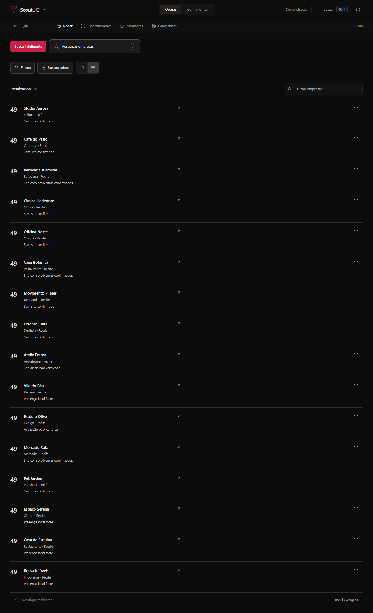
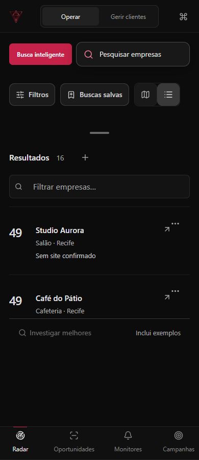
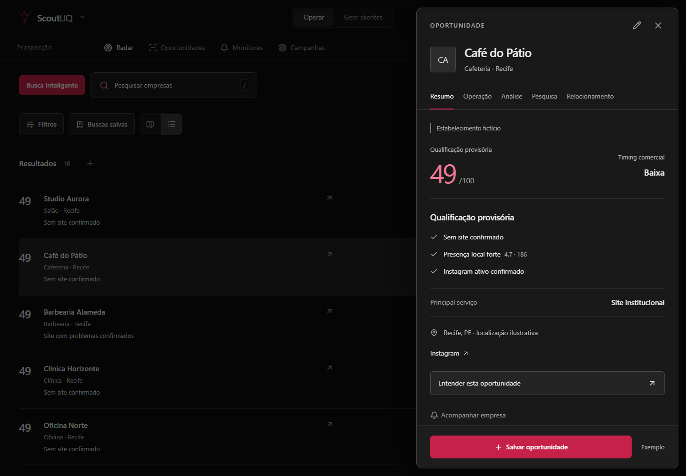
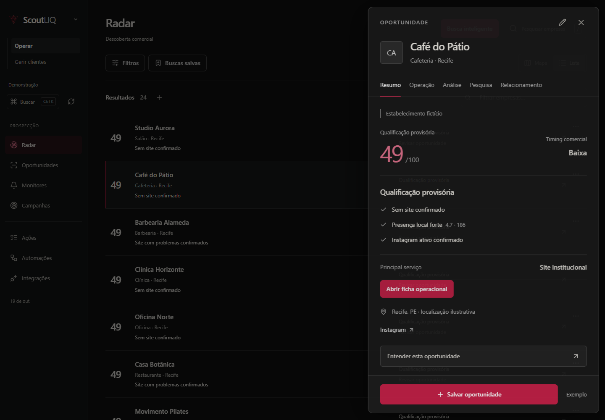

# Comparação visual e avaliação crítica

Capturas de Chromium local com dados sintéticos. Antes: FULL v1.35. Depois: candidato v1.36. A base de teste recebeu registros durante os E2E; contagens e empresas de QA podem diferir. A comparação é de composição e interação, não de qualidade comercial ou igualdade do conjunto de dados.

## Radar — desktop

Antes:

Depois:

## Radar — 390 px

Antes:

Depois:

## Ficha

Antes:

Depois:

## Revisão crítica

- A ação principal do Radar é buscar oportunidades; o mapa passa a ser uma ferramenta explícita. Foi verificado que o chunk do mapa só é solicitado ao abrir essa visualização.
- Linhas usam nome, localização, evidência e próxima ação; não criam novo score. Dados incompletos continuam provisórios. Uma lista de demonstração não comprova melhoria de conversão.
- Filtros separados do formulário de descoberta e memória por superfície reduzem reconstrução de contexto.
- Ficha mantém identidade/abas e oferece entrada direta no trabalho. Três etapas mantêm conteúdo montado e edição ao alternar. A revisão humana continua acessível sem duplicar painel.
- Critérios interpretados ficam visíveis; detalhes editáveis recolhidos. Limites e bloqueios permanecem explícitos.
- Comunicação revela formulários somente quando há configuração e conta conectada. Aprovar texto continua diferente de autorizar envio; não simplificamos as guardas de contato.
- Tablets recebem navegação compacta para evitar estreitar excessivamente as tabelas. Mobile conserva os mesmos serviços e ações.
- Desktop, mapa e comunicação mobile foram inspecionados visualmente. Os testes de acessibilidade e reflow complementam essa inspeção; não substituem avaliação por operadores reais.

Pendências de experiência: textos herdados de inteligência/comunicação ainda têm trechos PT em EN/ES; CSS global fora do shell/Radar/etapas não foi integralmente convertido em módulos; usabilidade com operadores reais e tecnologias assistivas físicas ainda não homologada. Não afirmar remake integral de cada formulário legado.
